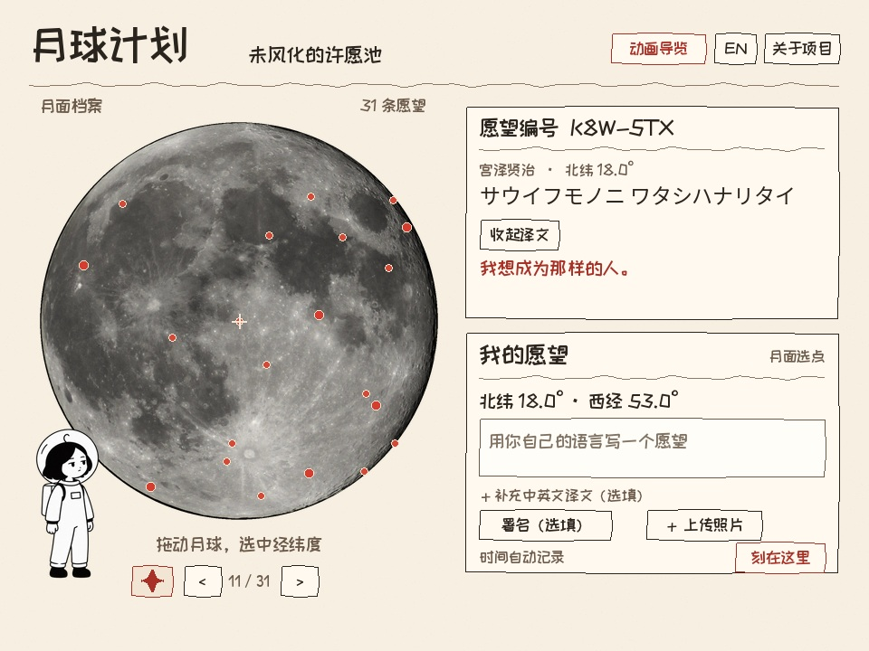

# 月球计划 · Moon Plan

[简体中文](#简体中文) · [English](#english)



*网站界面示意图 / Website interface preview*

*满月实拍 / Full Moon photograph by [Luc Viatour](https://www.astro4edu.org/zh-hans/resources/media/e078zz144Z45/), [CC BY-SA 3.0](https://creativecommons.org/licenses/by-sa/3.0/). 照片经裁切、缩放 / Cropped and resized.*

## 简体中文

### 未风化的许愿池
**在数字月面上选一个坐标，留下一个愿望。**

月球上没有地球上的风和雨，阿波罗宇航员留下的脚印能保存很久。我想把这种「留下痕迹」的体验做成一个网页。你可以拖动月球，在月面上找一个喜欢的位置，把愿望留在那里。也可以点开红点，看看别人曾经盼望过什么。

如果将来有更多人把愿望留在同一张月图上，这里可以成为一座记录人们想要什么的数字档案馆。假如两百年后，去月球已经像出门旅行一样平常，也许有人会带着这份档案上去，照着我们今天选好的坐标，把愿望一条条刻到真正的月球上。

## 试玩

打开[月球计划网页版](https://moon-wish-pool-xiubing.xiubing.chatgpt.site/)。托管版目前需要登录。也可以用下文的本地运行方式体验源码版。

1. 用鼠标拖动或在触屏上滑动月球。也可以聚焦月球后用方向键转动。画面中央的十字对应当前选中的经纬度。
2. 点击月面红点，查看一条预置愿望。点「翻译」可以展开该条目随附的译文。
3. 点击小星星，让不同语言的文学摘录依次出现在月面上。再次点击可以收起这一组红点。
4. 在「我的愿望」里写下愿望，按需填写署名、附图或补充译文。点「刻在这里」，它就会变成一个带编号、时间和坐标的新红点。

### 愿望存在哪里

当前版本使用浏览器的 **IndexedDB**，愿望和附图保存在提交时使用的浏览器里。清除该站点数据会移除本地记录。公开共享月图和跨设备同步是未来的设想。预置愿望使用随项目维护的译文，自己填写的愿望可手动补充译文。

## 本地运行

项目使用静态 HTML、CSS 和 JavaScript。安装 Python 3 后，在仓库根目录运行：

```sh
python3 -m http.server 8000 --directory dist
```

打开 [http://localhost:8000/](http://localhost:8000/)。也可以把 `dist/` 作为静态网站的发布目录。

## 项目结构

| 路径 | 用途 |
| --- | --- |
| `dist/index.html`、`dist/style.css` | 主页和手绘界面 |
| `dist/app.js` | 愿望交互、浏览器存储、月球渲染 |
| `dist/trackball.js` | 球体旋转、经纬度转换和正射投影 |
| `dist/literary.js` | 多语言摘录、译文和红点坐标 |
| `dist/guide.html`、`dist/guide.js` | 片头动画导览播放器 |

## 素材与再使用

- 源码版使用示意月球纹理。第三方人物照片、导览照片及含第三方素材的成片未收录。
- 有权发布的导览视频可放在 `dist/guide-assets/moon-guide.mp4`，播放器会加载它。
- 两款随附字体的授权见 `dist/*-OFL.txt`。转载文字摘录和项目角色图时请分别确认相应许可。

创作 · 修饼

---

## English

### The Unweathered Wishing Well

**Pick a spot on the digital Moon and leave a wish.**

The Moon has neither the wind nor the rain we know on Earth, so the footprints left by the Apollo astronauts can last a long time. I wanted to turn that idea of leaving a mark into a website. Spin the Moon to find a place for your own wish, or open a red dot to see what someone else once hoped for.

If more people someday leave wishes on a shared lunar map, it could become an archive of what people wished for. Imagine that, two hundred years from now, traveling to the Moon is as ordinary as taking a trip. Someone might bring the archive along and inscribe the wishes on the real Moon at the coordinates we chose today.

### Try it

Open the [Moon Plan website](https://moon-wish-pool-xiubing.xiubing.chatgpt.site/). The hosted version currently requires sign-in. You can also run the source locally using the steps below.

1. Drag the Moon with your mouse or swipe on a touchscreen. You can also focus the Moon and use the arrow keys. The crosshair marks your selected latitude and longitude.
2. Open a red dot to read a preset wish. Select **Translate** to reveal its accompanying translation where available.
3. Select the small star to reveal literary excerpts in several languages. Select it again to hide that group of markers.
4. Write your wish under **My wish**. You can add a signature, an image, or a translation. Select **Leave it here** to add a red marker with an ID, timestamp, and lunar coordinates.

### Where wishes are stored

The current version uses browser **IndexedDB**. Wishes and attachments live in the browser that submitted them. Clearing the site's data removes those local records. A shared lunar map and cross-device sync are future ideas. Preset translations are supplied with the project, and you can provide a translation for a wish you write.

### Run locally

The project uses static HTML, CSS, and JavaScript. With Python 3 installed, run this command from the repository root:

```sh
python3 -m http.server 8000 --directory dist
```

Open [http://localhost:8000/](http://localhost:8000/). You can also publish `dist/` using a static web host.

### Project layout

| Path | Purpose |
| --- | --- |
| `dist/index.html`, `dist/style.css` | Main page and hand-drawn interface |
| `dist/app.js` | Wish interactions, browser storage, and Moon rendering |
| `dist/trackball.js` | Globe rotation, coordinate conversion, and orthographic projection |
| `dist/literary.js` | Multilingual excerpts, translations, and marker coordinates |
| `dist/guide.html`, `dist/guide.js` | Animated guide player |

### Assets and reuse

- This source release uses an illustrative Moon texture. Third-party portraits, guide photos, and the finished video containing those assets are omitted from this repository.
- To enable the guide, place an MP4 you have permission to publish at `dist/guide-assets/moon-guide.mp4`.
- See `dist/*-OFL.txt` for the included font licenses. Check the applicable permissions before redistributing the character artwork or quoted text.

Created by 修饼 (Xiubing).
